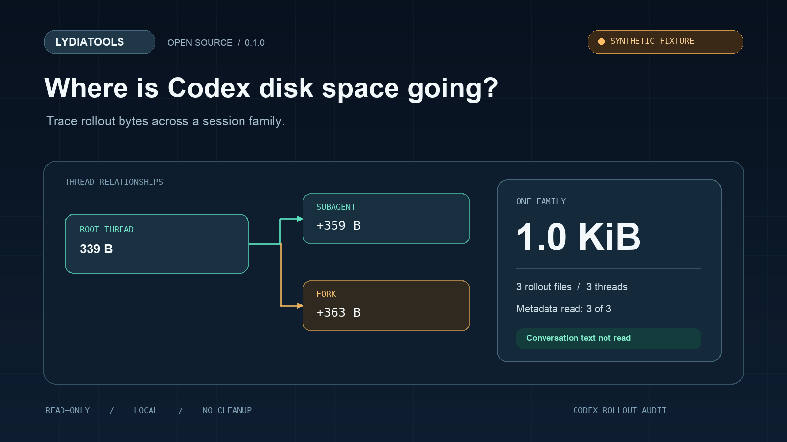

# Codex Rollout Audit

**Find which Codex session family is using your disk — without opening conversation text.**

Codex Rollout Audit is a small, read-only command-line report for local Codex rollout files. It totals file sizes and groups rollouts using the thread relationships recorded in Codex session metadata.

## Why this exists

Large local session files can be hard to attribute to the work that created them. Recent reports in the Codex issue tracker describe rollout storage reaching tens to hundreds of gigabytes, including cases involving subagents and forks. This tool helps answer a narrower, practical question: **which recorded session family accounts for the bytes on disk?**

Examples are [a report about rollout storage growth](https://github.com/openai/codex/issues/34337) and [a report focused on subagent disk use](https://github.com/openai/codex/issues/34061). These are user reports, not measurements of prevalence. The scanner uses the public [Codex rollout metadata shape](https://github.com/openai/codex/blob/main/codex-rs/app-server/tests/common/rollout.rs#L1498-L1576) as a format reference.

It is an early preview. The reports are user-submitted examples, not a measurement of how common the issue is. The tool has not yet been validated against a broad set of real Codex installations.

## What it does

- Scans .jsonl rollout files and adds their on-disk sizes.
- Reads only the first metadata line of each plain JSONL file.
- Groups files by recorded session, parent-thread, and fork relationships.
- Shows total, subagent-linked, and fork-linked bytes per family.
- Counts .jsonl.zst sizes without decompressing them; their relationships remain unknown.
- Skips symlinks and never writes, deletes, truncates, or uploads files.
- Offers text and JSON output, with optional relative paths for local investigation.

## Quick start

Requires Python 3.9 or later. Runtime dependencies: Python standard library only.

~~~sh
python -m pip install .
~~~

By default, the command scans ~/.codex/sessions:

~~~sh
codex-rollout-audit
~~~

To inspect another Codex data directory or save a machine-readable report:

~~~sh
codex-rollout-audit --root "$HOME/.codex/sessions" --top 30 --show-paths
codex-rollout-audit --json > rollout-audit.json
~~~

The report shows only the scanned directory's short label. With --show-paths it includes relative file paths; review a report before sharing it.

## Example

The included fixture is synthetic and contains metadata only:

~~~sh
python -m codex_rollout_audit --root examples/demo/sessions --show-paths
~~~

A sample report is available in [examples/demo/report.txt](examples/demo/report.txt).

## How grouping works

The scanner uses the session_meta record at the start of a rollout and the IDs it contains. It joins records that share a session ID, then joins known parent-thread and fork references when the referenced rollout is present under the scanned directory. The short family label is a one-way hash, not a Codex conversation ID.

A parent file outside the scanned root, a missing metadata line, or a compressed rollout can prevent relationship grouping. The report calls these cases out instead of guessing. File sizes are exact filesystem sizes at scan time; family attribution depends on the available metadata.

## Scope and limits

- This is a local disk-usage audit, not a cleanup tool. It never changes or removes data.
- It does not read messages, prompts, tool output, attachments, or database contents.
- It does not inspect SQLite/WAL storage, logs outside the sessions directory, or cloud storage.
- Compressed .jsonl.zst files are counted but not decompressed or attributed to a family.
- A relationship in metadata does not prove that one rollout caused another rollout's size.
- The project does not claim a particular amount of storage savings or that every Codex installation uses the same file layout.

## Report a problem

Please include your OS, Codex version, the command used, and a redacted summary. Do not attach session files or conversation text. Use GitHub Issues for bugs and format support requests.

## License

MIT. This project is independent and is not an official OpenAI product.
